# Soar DNS Tunnel — High-Performance Loss-Tolerant DNS Tunnel

[](https://github.com/mahdigholamipak/soar-tunnel/actions/workflows/ci.yml)
[](https://github.com/mahdigholamipak/soar-tunnel/actions/workflows/release.yml)
[](LICENSE)
[](https://github.com/mahdigholamipak/soar-tunnel/releases/latest)

> 🌐 **Language Switcher:** **[English]** | **[راهنمای جامع فارسی (Persian Guide)](README_FA.md)**

An open-source, production-ready DNS tunneling ecosystem built upon the modern, loss-tolerant **Soar** protocol. Engineered specifically for severely restricted, censored, or blacked-out environments (such as Iran's National Intranet / Internet Shutdowns, Russia, and China) where traditional VPN/TLS protocols (VLESS, VMess, Shadowsocks, WireGuard, SSH) are aggressively blocked or throttled.

---

## 🎯 What Soar Tunnel Is (and What It Is NOT)

To set realistic expectations and ensure the best experience, please understand the physical nature of DNS tunneling:

| Category | Realities & Intent |
| :--- | :--- |
| **✅ What It IS** | **An Emergency Censorship Survival Tool.** When all foreign TCP/TLS connections are cut during total internet blackouts, recursive UDP port 53 DNS queries to domestic resolvers remain permitted. Soar tunnels your encrypted traffic inside standard DNS queries. |
| **✅ Ideal Use Cases** | Messaging (Telegram, Signal, WhatsApp), web browsing, Twitter/X, email, essential social media, and administrative access during shutdowns. |
| **⚡ Expected Speed** | Real-world speeds range between **300 Kbps and 2.5 Mbps** with latencies of 150ms–600ms. |
| **❌ What It is NOT** | It is **NOT** a gigabit replacement for everyday VPNs. It is not designed for 4K video streaming, high-speed torrent downloads, or competitive online gaming. |
| **🔒 Deployment Model** | **Self-Hosted / Small Group:** DNS tunneling generates high query volume. Sharing one public domain across hundreds of users will cause ISP resolvers to rate-limit the domain. Run your own VPS for you and your family/friends for optimal reliability. |

---

## 🏗️ How It Works (Architecture Overview)

```mermaid
flowchart LR
    subgraph User["User Device (Android / Windows / Linux)"]
        App["App / Browser / Telegram"]
        Client["Soar Client (SOCKS5 Proxy)<br/>127.0.0.1:10850"]
        App -->|"SOCKS5 traffic"| Client
    end

    subgraph Domestic["Domestic / Local Network (Intranet)"]
        Resolvers["Local ISP & Anycast Resolvers<br/>(Port 53 UDP)"]
        Client -->|"Encrypted Base32 DNS Queries<br/>*.s.example.com"| Resolvers
    end

    subgraph Authority["Cloudflare Authoritative DNS"]
        CF["Cloudflare NS Delegation<br/>s.example.com ➔ ns.example.com"]
        Resolvers -->|"Recursive Query Forwarding"| CF
    end

    subgraph VPS["Foreign Unfiltered Server"]
        Server["Soar Server (UDP :53)<br/>ns.example.com"]
        Web["Free World Internet"]
        CF -->|"Delegated Packets"| Server
        Server -->|"Decrypted TCP/UDP"| Web
    end
```



---

## 🌟 Key Features

- **Blazing Fast Protocol**: Zero-RTT connection initiation, loss-tolerant selective retransmissions, and out-of-order segment assembly.
- **Smart Adaptive Real-Time Network Tuner (RFC 6298 EWMA)**: Dynamically adjusts connection timeouts, jitter metrics, and auto-scales Reed-Solomon Forward Error Correction (FEC) redundancy between **12.5% and 33.3%** during severe packet loss.
- **Multi-Domain Failover & Racing**: Configure multiple subdomains (`DOMAINS = ["s1.domain.com", "s2.domain.com"]`). If one domain is throttled or blacklisted by an ISP, the client switches instantly without disconnecting your streams.
- **Privacy Shield & Redaction (`soar://locked`)**: Share server configurations without exposing sensitive domain names or server keys in client logs.
- **Modern Android App (v1.4.2)**: Sleek Material 3 design, parallel latency tester, live resolver ranking, QR code sharing, clipboard auto-detection, and background Foreground Service exposing SOCKS5 on `127.0.0.1:10850`.
- **Windows GUI App**: Dark-mode desktop client with real-time streaming telemetry and one-click **Windows System Proxy** integration.
- **Stream Idle Watchdog**: Automatically purges stale or abandoned streams after an inactivity timeout (default 60s), preventing session table memory leaks.
- **Automated Server Installer & Management CLI**: Single-line bash script that configures `systemd`, generates Ed25519 keys, handles port conflicts, and provides the `soar` management menu.
- **100% Automated CI/CD**: All platform builds (Linux, Windows GUI, Android APK) are compiled directly inside GitHub Actions.

---

## 🚀 0 to 100 Setup Guide

### Phase 1: Cloudflare DNS Setup (CRITICAL)

DNS tunneling relies on delegating a subdomain to your VPS nameserver. You need **one registered domain** added to [Cloudflare](https://dash.cloudflare.com) (free plan).

Assuming your domain is `example.com` and your VPS IP is `198.51.100.1`:

| Type | Name | Content / Target | Proxy Status | Description |
| :--- | :--- | :--- | :--- | :--- |
| **A** | `ns` | `198.51.100.1` | **DNS Only (Grey Cloud - OFF)** | Glue record pointing to your VPS IP |
| **NS** | `s` | `ns.example.com` | **DNS Only (Auto)** | Delegates `s.example.com` to your VPS |

> [!CAUTION]
> The `A` record (`ns`) MUST have proxying **turned OFF** (Grey cloud icon). Cloudflare cannot proxy arbitrary UDP port 53 traffic.
> 
> If you have multiple domains, repeat this setup for each domain (e.g., `s.example1.com`, `s.example2.net`). Soar natively supports concurrent multi-domain failover.

---

### Phase 2: One-Line Server Installation

SSH into your Linux VPS (Ubuntu 20.04+, Debian 11+, or CentOS/AlmaLinux) as `root`:

```bash
curl -sSL https://raw.githubusercontent.com/mahdigholamipak/soar-tunnel/main/scripts/install.sh | bash
```

The automated script will:
1. Detect system architecture (`amd64` / `arm64`).
2. Download and verify the latest `soar-server` binary.
3. Automatically generate a unique Ed25519 cryptographic keypair.
4. Prompt for your delegated domains (e.g., `s.example.com` or `s.domain1.com,s.domain2.com`).
5. Resolve port 53 conflicts (with `systemd-resolved` or `bind9`) and configure `systemd` (`soar.service`).
6. Display your **Server Public Key**, connection link, and ASCII QR Code.

#### Server Management Menu:
Run `soar` anytime on your server to open the interactive dashboard:
```bash
soar              # Open interactive server management menu
soar status       # Check service status, active IP, and domains
soar share        # Display standard connection link & terminal QR code
soar share-locked # Generate privacy-protected locked share link (masks domains/keys)
soar update       # Single-command update to latest GitHub release
soar logs         # Follow live server traffic logs
```

---

### Phase 3: Client Setup

#### 📱 Option A: Android (App v1.4.2)
1. Download `Soar-Android-ProxyOnly.apk` from the [Latest Release](https://github.com/mahdigholamipak/soar-tunnel/releases/latest) and install it.
2. Open the app:
   - **Manual:** Enter your **Server Public Key** and **Tunnel Domains** (e.g. `s.example.com`).
   - **One-Click:** If you copied a `soar://` link, the app auto-detects it on launch, or tap **Import Link**.
3. Tap **CONNECT**. A foreground notification will appear indicating the tunnel is active.
4. Configure your apps to use the local SOCKS5 proxy:
   - **Telegram**: Tap **"Set in Telegram"** to auto-configure, or enter `127.0.0.1:10850` in Telegram Proxy Settings.
   - **v2rayNG / Matsuri / Nekobox / Browsers**: Set SOCKS5 outbound to `127.0.0.1:10850`.
5. **Resolvers Tab**: Tap **"⚡ Test All Latency"** to test 40+ domestic Iranian and global DNS resolvers in parallel and rank them by speed.

#### 🖥️ Option B: Windows (Native GUI Client)
1. Download `Soar-Windows-GUI-win64.zip` from the [Latest Release](https://github.com/mahdigholamipak/soar-tunnel/releases/latest).
2. Extract the ZIP file into a folder.
3. Launch `Soar-Windows-GUI.exe`.
4. Paste your **Server Public Key** and **Tunnel Domains**.
5. Check **"Set as Windows System Proxy"** if you want your entire browser and Windows system apps to route through Soar automatically.
6. Click **CONNECT**.

#### 💻 Option C: CLI Client (Linux / macOS / Windows)
Run directly from terminal:
```bash
./soar-client -zones "s.example1.com,s.example2.com" -pubkey "YOUR_BASE64_KEY=" -listen 127.0.0.1:10850
```

Or using a TOML configuration file:
```bash
./soar-client -config client_config.toml
```

---

## ⚙️ Configuration Reference

### Client Configuration (`client_config.toml`)
```toml
# Tunnel domains (supports multiple for automatic failover)
DOMAINS = ["s.example1.com", "s.example2.com"]

# Server Ed25519 Public Key
SERVER_PUBLIC_KEY = "zMZc9V2KV3JAK/lZWUn0uBpW9HsobYXjrpiDgJ+UMCY="

# Local SOCKS5 listener
LISTEN_IP = "127.0.0.1"
LISTEN_PORT = 10850

# Path to candidate DNS resolvers
RESOLVERS_FILE = "client_resolvers.txt"

# Inactive stream timeout in seconds (prevents leaking hanging connections)
STREAM_IDLE_TIMEOUT_SECONDS = 60.0

# Timeout per dial attempt before trying next domain
DIAL_TIMEOUT_SECONDS = 12.0

# Logging verbosity: "INFO", "DEBUG", "WARN", "ERROR"
LOG_LEVEL = "INFO"
```

### Server Configuration (`/etc/soar/server.conf`)
The server daemon is managed via `systemd` (`/etc/systemd/system/soar.service`) and reads its settings from `/etc/soar/server.conf`:
```ini
SERVER_IP="198.51.100.1"
ZONES="s.example1.com,s.example2.com"
PUB_KEY="YOUR_BASE64_PUBLIC_KEY"
LISTEN_ADDR="0.0.0.0:53"
BEHIND_COTTEN="false"
EGRESS_PROXY=""
```

---

## 🔀 Co-existence with CottenRouter (Running Multiple DNS Tunnels)

If you use [CottenRouter](https://github.com/TaJirax/CottenRouter) as a DNS reverse proxy on port 53 to host multiple DNS tunneling services concurrently:

1. **Automatic Port Discovery (Zero Conflict with StormDNS & Others):**
   The installer automatically detects CottenRouter, protects well-known ports (5301 CottenDNS, 5302 SlipGate, 5303 StormDNS), and binds Soar to the first available `53xx` port (e.g. `127.0.0.1:5304`):
   ```bash
   curl -sSL https://raw.githubusercontent.com/mahdigholamipak/soar-tunnel/main/scripts/install.sh | bash -s -- --cotten
   ```
2. **Add Route to CottenRouter:**
   Add the generated JSON rule to `/etc/cottenrouter/config.json` (or via `cottenrouter tui` / `soar cotten`):
   ```json
   {
     "suffix": "s.example.com",
     "address": "127.0.0.1:5304"
   }
   ```
   Then reload: `systemctl restart cottenrouter`.
3. **Clients Unchanged:** Android and Windows clients connect via standard DNS port 53 without needing any custom port configuration.

---

## 🔧 Troubleshooting & Frequently Asked Questions (FAQ)

### 1. The client says `context deadline exceeded` or `all domains failed to dial`
* **Check Cloudflare Proxy Status:** Ensure the `A` record (`ns`) has the **Grey Cloud (DNS Only)**. If the Orange Cloud is ON, Cloudflare drops UDP port 53 packets.
* **Check VPS Firewall:** Ensure port 53 UDP is open on your VPS firewall:
  ```bash
  ufw allow 53/udp
  ```
  If hosting on AWS/Hetzner/Oracle Cloud/DigitalOcean, check your cloud security group / network firewall inbound rules.
* **DNS Propagation:** DNS delegation can take 5–15 minutes to propagate worldwide. Test from your machine:
  ```bash
  nslookup s.example.com YOUR_VPS_IP
  ```

### 2. Port 53 already in use during server installation (`address already in use`)
* Many Linux distributions run `systemd-resolved` by default on `127.0.0.53:53`. The Soar installer automatically frees port 53. If doing manual setup, disable the stub listener:
  ```bash
  systemctl stop systemd-resolved
  systemctl disable systemd-resolved
  ```

### 3. Android client disconnects when screen is turned off
* Android's aggressive battery manager may kill background processes. To prevent this:
  * Go to **Settings** ➔ **Apps** ➔ **Soar Tunnel** ➔ **Battery** ➔ Select **Unrestricted** (or disable Battery Optimization).

### 4. Telegram connects but web pages won't open
* Telegram connects directly through SOCKS5. If you want your web browser to use the tunnel, install a proxy extension like **SwitchyOmega** (Chrome/Firefox) and set SOCKS5 to `127.0.0.1:10850`, or on Windows, toggle **"Set as Windows System Proxy"** in the Soar GUI.

---

## 🔒 Security & Privacy Model

- **End-to-End Cryptography**: Communication is authenticated and encrypted end-to-end using Ed25519 and ChaCha20-Poly1305. Intermediary DNS resolvers and ISPs cannot inspect or modify your payloads.
- **Redaction Shield (`soar://locked`)**: Protects server owners from accidental domain and key leaks when sharing configurations with friends or community members.
- **RFC 1918 Private Range Protection**: The server blocks proxying to private LAN subnets by default, preventing unauthorized internal network pivoting.

---

## 🙏 Credits & Attribution

This project is built directly upon the core **Soar** loss-tolerant DNS tunneling protocol invented and open-sourced by **Lantern** ([github.com/getlantern/soar](https://github.com/getlantern/soar)) under the Apache License 2.0. We express our deepest gratitude to the Lantern engineering team for their pioneering research in censorship circumvention.

This ecosystem extends the foundational protocol with:
- Intelligent Multi-Domain Failover & Racing
- Smart Adaptive Network Tuner (RFC 6298 EWMA & dynamic Reed-Solomon FEC scaling)
- Windows GUI Client with System Tray & Live Telemetry
- Android Material 3 Client with parallel resolver ranking and QR sharing
- Privacy Shield Redaction (`soar://locked`)
- Production-grade CI/CD and single-line deployment automation

---

## 📄 License

This project is licensed under the Apache License 2.0. See the [LICENSE](LICENSE) file for details.
