# راهنمای جامع تونل دی‌ان‌اس Soar — دورزدن پایدار فیلترینگ و اینترنت ملی

[](https://github.com/mahdigholamipak/soar-tunnel/actions/workflows/ci.yml)
[](https://github.com/mahdigholamipak/soar-tunnel/actions/workflows/release.yml)
[](LICENSE)
[](https://github.com/mahdigholamipak/soar-tunnel/releases/latest)

> 🌐 **تغییر زبان:** **[English (راهنمای انگلیسی)](README.md)** | **[فارسی]**

پروژه **Soar DNS Tunnel** یک اکوسیستم تونل‌سازی پیشرفته، متن‌باز و بسیار مقاوم در برابر فیلترینگ شدید است که بر بستر پروتکل مدرن و تاب‌آور **Soar** پیاده‌سازی شده است. این ابزار به طور ویژه برای محیط‌های تحت سانسور شدید و **شرایط قطع کامل اینترنت بین‌الملل (اینترنت ملی / سد فیلترینگ TIC)** توسعه یافته است؛ شرایطی که تمامی پروتکل‌های سنتی مانند VLESS، VMess، Shadowsocks، WireGuard و SSH مسدود می‌شوند اما تبادل بسته‌های استاندارد DNS (پورت UDP 53) با سرورهای نام مجاز است.

---

## 🎯 این پروژه چیست و چه چیزی نیست؟ (شفاف‌سازی انتظارات)

پروتکل‌های مبتنی بر تونل دی‌ان‌اس دارای ویژگی‌های فیزیکی و ساختاری خاصی هستند. برای داشتن بهترین تجربه، به جدول زیر توجه کنید:

| دسته‌بندی | واقعیت و هدف پروژه |
| :--- | :--- |
| **✅ این پروژه چیست؟** | **ابزار بقا و دسترسی اضطراری به اینترنت آزاد.** هنگامی که تمام راه‌های ارتباطی قطع شده‌اند، این سیستم بسته‌های رمزنگاری‌شده شما را درون درخواست‌های استاندارد DNS بسته‌بندی کرده و از سد شبکه ملی عبور می‌دهد. |
| **📱 کاربرد ایده‌آل** | پیام‌رسانی و تماس صوتی در تلگرام و واتساپ، وب‌گردی، مرور اخبار، توییتر/X، ایمیل و کارهای مدیریتی ضروری در زمان خاموشی اینترنت. |
| **⚡ سرعت واقعی** | سرعت واقعی تبادل داده بین **۳۰۰ کیلوبیت تا ۲.۵ مگابیت بر ثانیه** با پینگ متغیر بین ۱۵۰ تا ۵۰۰ میلی‌ثانیه است. |
| **❌ این پروژه چه چیزی نیست؟** | این سیستم **جایگزین فیلترشکن‌های گیگابیتی پرسرعت روزمره نیست**. برای استریم ویدیوهای 4K، دانلودهای حجیم چند گیگابایتی یا بازی‌های آنلاین حساس به پینگ پایین طراحی نشده است. |
| **🔒 مدل استقرار استاندارد** | **استفاده شخصی یا خانوادگی (Self-Hosted):** ترافیک پرس‌وجوی DNS بسیار بالاست. اشتراک‌گذاری یک دامنه عمومی با صدها کاربر ناشناس باعث مسدود یا Rate-Limit شدن آن توسط ریزالورهای مخابرات می‌شود. بهترین حالت، راه‌اندازی سرور اختصاصی برای خود و اطرافیانتان است. |

---

## 🏗️ نحوه کارکرد سیستم (معماری انتقال داده)

```mermaid
flowchart LR
    subgraph User["دستگاه کاربر (گوشی یا کامپیوتر)"]
        App["تلگرام / مرورگر / برنامه‌ها"]
        Client["کلاینت Soar (پروکسی لوکال)<br/>127.0.0.1:10850"]
        App -->|"ترافیک SOCKS5"| Client
    end

    subgraph Domestic["شبکه داخلی کشور (اینترنت ملی)"]
        Resolvers["ریزالورهای داخلی و محلی اپراتورها<br/>(پورت UDP 53)"]
        Client -->|"درخواست‌های رمزنگاری‌شده Base32<br/>*.s.example.com"| Resolvers
    end

    subgraph Authority["سرور کلودفلر (Cloudflare NS)"]
        CF["تفویض دامنه کلودفلر<br/>s.example.com ➔ ns.example.com"]
        Resolvers -->|"ارسال بازگشتی دی‌ان‌اس"| CF
    end

    subgraph VPS["سرور مجازی خارج کشور (VPS)"]
        Server["سرور Soar (پورت UDP 53)<br/>ns.example.com"]
        Web["اینترنت آزاد بین‌الملل"]
        CF -->|"بسته‌های تفویض‌شده"| Server
        Server -->|"ترافیک رمزگشایی‌شده"| Web
    end
```



---

## 💎 مزایای کلیدی Soar Tunnel

1. **پروتکل سریع و بدون تاخیر اتصال (Zero-RTT):** آغاز آنی ارتباط با حداقل پکت‌های تبادلی و مونتاژ قطعات داده خارج از ترتیب (Out-of-order Reassembly).
2. **تیونر خودتنظیم‌گر هوشمند شبکه (Smart Adaptive Tuner):** پایش بلادرنگ تاخیر (RTT) و پکت‌لاس با الگوریتم RFC 6298 EWMA؛ تنظیم پویای افزونگی کدهای تصحیح خطا (FEC) از **۱۲.۵٪ تا ۳۳.۳٪** در زمان افت کیفیت شبکه یا تشدید فیلترینگ.
3. **پشتیبانی از چندین دامنه همزمان (Multi-Domain Failover & Racing):** قابلیت تعریف چندین ساب‌دامین (`DOMAINS = ["s1.ir", "s2.com"]`)؛ در صورت مسدود شدن یا اختلال روی یک دامنه، کلاینت بلافاصله و بدون قطعی استریم به دامنه بعدی سوئیچ می‌کند.
4. **سپر حریم خصوصی و ضد نشت مشخصات (`soar://locked`):** امکان ساخت لینک اشتراک قفل‌شده که مشخصات دامنه‌ها و کلیدهای سرور را در لاگ‌ها به شکل `[protected-domain]` ماسک می‌کند.
5. **اپلیکیشن مدرن اندروید (نسخه v1.4.2):** طراحی جذاب متریال ۳، تست پینگ موازی روی بیش از ۴۰ ریزالور ملی و جهانی، اسکنر QR Code، تشخیص خودکار لینک از کلیپ‌بورد و پروکسی لوکال SOCKS5 روی `127.0.0.1:10850`.
6. **رابط گرافیکی مدرن ویندوز (GUI):** نرم‌افزار سبک تک‌فایلی دسکتاپ با آمار لحظه‌ای ترافیک و سوییچ تک‌کلیکه **پروکسی کل سیستم ویندوز (System Proxy)**.
7. **دیده‌بان استریم‌های معلق (Stream Idle Watchdog):** بستن خودکار اتصالات رهاشده و بدون فعالیت (پس از ۶۰ ثانیه) برای جلوگیری از نشت حافظه رم.
8. **اسکریپت راه‌اندازی تک‌خطی و منوی مدیریت `soar`:** نصب کامل سرور و ایجاد سرویس سیستم‌دی در کمتر از ۳۰ ثانیه.
9. **پایپ‌لاین بیلد امن گیت‌هاب (CI/CD):** تمام فایل‌های اجرایی و باینری‌ها مستقیماً و به صورت خودکار توسط سرورهای گیت‌هاب کامپایل می‌شوند.

---

## 🛠️ آموزش قدم‌به‌قدم راه‌اندازی (از ۰ تا ۱۰۰)

### گام ۱: تنظیم رکوردهای دی‌ان‌اس در کلودفلر (بسیار مهم)

برای اینکه درخواست‌های دی‌ان‌اس از سراسر جهان به سرور شما هدایت شوند، باید یک زیردامنه را به سرور مجازی خارج خود تفویض (Delegate) کنید. یک دامنه رایگان یا ثبتی به پنل [Cloudflare](https://dash.cloudflare.com) اضافه کنید.

فرض کنید:
- دامنه شما: `example.com`
- آی‌پی سرور مجازی خارج: `198.51.100.1`

وارد داشبورد دامنه در کلودفلر شده، به منوی **DNS Records** بروید و دو رکورد زیر را بسازید:

| Type (نوع) | Name (نام رکورد) | IPv4 / Target (مقصد) | Proxy Status (وضعیت پروکسی) | توضیحات |
| :--- | :--- | :--- | :--- | :--- |
| **A** | `ns` | `198.51.100.1` | **DNS Only (ابر خاکستری / خاموش)** | رکورد چسبنده اشاره‌کننده به سرور |
| **NS** | `s` | `ns.example.com` | **DNS Only (Auto)** | تفویض ساب‌دامین `s.example.com` به سرور شما |

> [!CAUTION]
> **نکته بسیار حیاتی:** ابر رکورد `A` (یعنی `ns`) حتماً باید **خاکستری (خاموش)** باشد! کلودفلر نمی‌تواند ترافیک پورت ۵۳ سرور شما را پروکسی کند و در صورت روشن بودن ابر نارنجی، تونل اصلاً متصل نخواهد شد.
> 
> اگر چند دامنه دارید، می‌توانید این کار را برای دامنه‌های دیگر هم تکرار کنید (مثلاً `s.site2.com`). سیستم چنددامنه‌ای Soar به راحتی از همه آنها به صورت همزمان پشتیبانی می‌کند.

---

### گام ۲: نصب آسان سرور با دستور تک‌خطی

از طریق SSH (با ترمینال یا PuTTY) به عنوان کاربر `root` وارد سرور مجازی خود شوید و دستور زیر را اجرا کنید:

```bash
curl -sSL https://raw.githubusercontent.com/mahdigholamipak/soar-tunnel/main/scripts/install.sh | bash
```

#### اسکریپت چه مراحلی را طی می‌کند؟
1. معماری پردازنده سرور (`amd64` یا `arm64`) را شناسایی می‌کند.
2. آخرین باینری رسمی `soar-server` را دریافت و تایید می‌کند.
3. یک جفت کلید رمزنگاری اختصاصی و امن Ed25519 تولید می‌کند.
4. دامنه‌های تفویض‌شده شما را می‌پرسد (مثلاً `s.example.com` یا چند دامنه با کاما: `s.example.com,s.backup.ir`).
5. تداخل‌های پورت ۵۳ (مانند `systemd-resolved`) را برطرف کرده و سرویس پس‌زمینه `soar.service` را فعال می‌سازد.
6. در پایان، **کلید عمومی سرور (Server Public Key)**، لینک اتصال سریع و QR Code را به شما نمایش می‌دهد.

#### منوی مدیریت سرور:
در هر زمان با وارد کردن دستور `soar` در ترمینال سرور، داشبورد مدیریتی باز می‌شود:
```bash
soar              # باز کردن منوی مدیریت گرافیکی-متنی سرور
soar status       # مشاهده وضعیت سرویس و دامنه‌ها
soar share        # نمایش لینک اتصال و QR Code در ترمینال
soar share-locked # ساخت لینک اتصال قفل‌شده (حفاظت از کلیدها و دامنه‌ها)
soar update       # آپدیت خودکار سرور به آخرین نسخه رسمی گیت‌هاب
soar logs         # مشاهده لاگ‌های زنده ترافیک عبوری
```

---

### گام ۳: راه‌اندازی کلاینت‌ها

#### 📱 ۱. اندروید (اپلیکیشن رسمی نسخه v1.4.2)
1. فایل `Soar-Android-ProxyOnly.apk` را از [صفحه آخرین انتشار گیت‌هاب](https://github.com/mahdigholamipak/soar-tunnel/releases/latest) دانلود و نصب کنید.
2. برنامه را باز کنید:
   - اگر لینک سرور (`soar://`) را کپی کرده باشید، برنامه خودکار آن را تشخیص می‌دهد؛ همچنین می‌توانید روی **Import Link** بزنید یا مشخصات (کلید عمومی و دامنه‌ها) را دستی وارد کنید.
3. روی دکمه بزرگ **CONNECT** بزنید تا نوتیفیکیشن سرویس فعال شود.
4. **تنظیم تلگرام:** روی دکمه **"Set in Telegram"** بزنید تا تلگرام با پروکسی محلی باز شود؛ یا در تنظیمات پروکسی تلگرام مقدار `127.0.0.1:10850` (نوع SOCKS5) را ذخیره کنید.
5. **تنظیم سایر برنامه‌ها (v2rayNG / مرورگرها):** در هر ابزاری، آدرس پروکسی SOCKS5 را `127.0.0.1` و پورت را `10850` قرار دهید.
6. **تب ریزالورها (Resolvers):** وارد تب دوم شده و روی **⚡ Test All Latency** بزنید تا پینگ و سلامت بیش از ۴۰ سرور دی‌ان‌اس ملی و Anycast بررسی و بهترین‌ها برای اتصال انتخاب شوند.

#### 🖥️ ۲. ویندوز (رابط گرافیکی Native GUI)
1. فایل `Soar-Windows-GUI-win64.zip` را از [صفحه Releases](https://github.com/mahdigholamipak/soar-tunnel/releases/latest) دانلود و در یک پوشه استخراج کنید.
2. نرم‌افزار `Soar-Windows-GUI.exe` را اجرا کنید.
3. کلید عمومی و دامنه‌ها را وارد کنید.
4. تیک گزینه **Set as Windows System Proxy** را فعال کنید تا تمام مرورگرها و نرم‌افزارهای ویندوز بدون نیاز به تنظیمات دستی از تونل عبور کنند.
5. روی دکمه **CONNECT** کلیک کنید.

#### 💻 ۳. لینوکس / مک / خط فرمان (CLI)
می‌توانید کلاینت را مستقیماً با دستور زیر اجرا کنید:
```bash
./soar-client -zones "s.example1.com,s.example2.com" -pubkey "YOUR_BASE64_KEY=" -listen 127.0.0.1:10850
```

---

## ⚙️ راهنمای فایل‌های پیکربندی

### فایل تنظیمات کلاینت (`client_config.toml`)
```toml
# دامنه‌های تونل (پشتیبانی همزمان از چند دامنه برای سوئیچ خودکار)
DOMAINS = ["s.example1.com", "s.example2.com"]

# کلید عمومی سرور (Base64)
SERVER_PUBLIC_KEY = "zMZc9V2KV3JAK/lZWUn0uBpW9HsobYXjrpiDgJ+UMCY="

# آدرس و پورت لوکال پروکسی SOCKS5
LISTEN_IP = "127.0.0.1"
LISTEN_PORT = 10850

# مسیر فایل لیست ریزالورهای کاندید
RESOLVERS_FILE = "client_resolvers.txt"

# تایم‌اوت بستن استریم‌های رهاشده (به ثانیه)
STREAM_IDLE_TIMEOUT_SECONDS = 60.0

# مهلت اتصال به هر دامنه قبل از سوئیچ به دامنه بعدی
DIAL_TIMEOUT_SECONDS = 12.0

# سطح نمایش پیام‌ها در لاگ
LOG_LEVEL = "INFO"
```

---

## 🔧 راهنمای رفع اشکال و سوالات متداول (FAQ)

### ۱. خطای `context deadline exceeded` یا `all domains failed to dial` در کلاینت
* **بررسی ابر کلودفلر:** مطمئن شوید که رکورد `A` (نام `ns`) حتماً دارای **ابر خاکستری (DNS Only)** است. اگر ابر نارنجی روشن باشد، کلودفلر ترافیک پورت ۵۳ را مسدود می‌کند.
* **بررسی فایروال سرور VPS:** مطمئن شوید پورت ۵۳ روی پروتکل UDP در سرور باز است:
  ```bash
  ufw allow 53/udp
  ```
  اگر از سرورهای هتزنر، اوراکل یا آمازون استفاده می‌کنید، فایروال پنل ابری (Security Group) را بررسی کنید تا ترافیک ورودی Inbound روی UDP:53 مجاز باشد.
* **انتشار رکوردهای دی‌ان‌اس:** تفویض دامنه در کلودفلر ممکن است ۵ تا ۱۵ دقیقه طول بکشد تا در کل دنیا منتشر شود. برای تست در ترمینال کامپیوتر خود دستور زیر را بزنید:
  ```bash
  nslookup s.example.com آی‌پی_سرور_شما
  ```

### ۲. خطای اشغال بودن پورت ۵۳ در زمان نصب سرور (`address already in use`)
* در لینوکس اوبونتو سرویس `systemd-resolved` پورت ۵۳ را اشغال می‌کند. اسکریپت نصب ما به صورت خودکار آن را آزاد می‌کند. در صورت نصب دستی، کافی است آن را غیرفعال کنید:
  ```bash
  systemctl stop systemd-resolved
  systemctl disable systemd-resolved
  ```

### ۳. قطع شدن کلاینت اندروید بعد از خاموش شدن صفحه گوشی
* مدیریت باتری در اندروید ممکن است پردازنده کلاینت را به خواب ببرد. برای حل این مشکل:
  * به **Settings** ➔ **Apps** ➔ **Soar Tunnel** ➔ **Battery** رفته و حالت **Unrestricted** (بدون محدودیت باتری) را فعال کنید.

### ۴. تلگرام متصل می‌شود اما صفحات وب در مرورگر باز نمی‌شوند
* تلگرام مستقیماً از SOCKS5 پشتیبانی می‌کند. برای باز کردن سایت‌ها در مرورگرهای کامپیوتر یا گوشی:
  * در ویندوز تیک **"Set as Windows System Proxy"** را بزنید یا اکستنشن **SwitchyOmega** را در مرورگر کروم/فایرفاکس نصب کرده و روی SOCKS5 با پورت ۱۰۸۵۰ تنظیم کنید.
  * در اندروید می‌توانید از ابزارهایی مثل **v2rayNG** (ایجاد یک کانفیگ SOCKS5 دستی به مقصد `127.0.0.1:10850`) استفاده کنید تا کل ترافیک گوشی تونل شود.

---

## 🔀 همزیستی با CottenRouter (اجرای همزمان چند تونل DNS روی یک سرور)

اگر روی سرور خود از پروکسی معکوس [CottenRouter](https://github.com/TaJirax/CottenRouter) روی پورت ۵۳ استفاده می‌کنید تا سرویس‌های دیگری مثل CottenDNS یا StormDNS را همزمان فعال داشته باشید:

1. اسکریپت نصب به طور خودکار با سوئیچ `--cotten` پورت آزاد بعدی (مثلاً `127.0.0.1:5304`) را بدون دستکاری پورت ۵۳ انتخاب می‌کند:
   ```bash
   curl -sSL https://raw.githubusercontent.com/mahdigholamipak/soar-tunnel/main/scripts/install.sh | bash -s -- --cotten
   ```
2. قانون ایجاد شده را به `/etc/cottenrouter/config.json` اضافه و کاتن‌روتر را ری‌استارت کنید:
   ```json
   {
     "suffix": "s.example.com",
     "address": "127.0.0.1:5304"
   }
   ```
3. کلاینت‌ها بدون نیاز به هیچ تغییری متصل خواهند شد.

---

## 🔒 امنیت و حریم خصوصی

- **رمزنگاری سرتاسری (End-to-End):** تمام تبادلات با Ed25519 احراز هویت شده و با ChaCha20-Poly1305 به صورت سرتاسری رمزنگاری می‌شوند؛ هیچ اپراتور یا سرور واسطی قادر به مشاهده محتوا نیست.
- **حفاظت در برابر نشت مشخصات (`soar://locked`):** جلوگیری از افشای تصادفی دامنه‌ها و کلیدها در لاگ‌ها یا در زمان ارسال کانفیگ به دوستان.
- **حفاظت از رنج‌های شبکه داخلی (RFC 1918):** سرور به طور پیش‌فرض اتصال به آی‌پی‌های داخلی محلی را مسدود می‌کند تا امنیت شبکه سرور تضمین شود.

---

## 🙏 سپاس و تقدیر (Credits & Attribution)

این پروژه بر پایه پروتکل بنیادی و درخشان **Soar** طراحی شده که توسط تیم مهندسی **فانوس (Lantern)** در مخزن [github.com/getlantern/soar](https://github.com/getlantern/soar) تحت مجوز Apache License 2.0 خلق و متن‌باز شده است. صمیمانه از تحقیقات ارزشمند تیم Lantern در زمینه دور زدن سانسور اینترنت سپاسگزاریم.

اکوسیستم Soar Tunnel این پروتکل را با موارد زیر توسعه داده است:
- رقابت چنددامنه‌ای خودکار (Multi-Domain Racing & Failover)
- تیونر خودتنظیم‌گر پویا (RFC 6298 EWMA & Adaptive FEC Redundancy)
- کلاینت ویندوز با رابط گرافیکی مستقل و سینی ویندوز
- کلاینت مدرن اندروید بر پایه متریال ۳ با اسکن QR Code و رتبه‌بندی ریزالورها
- سامانه اشتراک امن و قفل‌شده (`soar://locked`)
- اسکریپت نصب خودکار و پایپ‌لاین CI/CD گیت‌هاب

---

## 📄 مجوز (License)

این پروژه تحت مجوز آپاچی نسخه ۲.۰ (Apache License 2.0) به صورت آزاد و متن‌باز در دسترس همگان قرار دارد.
